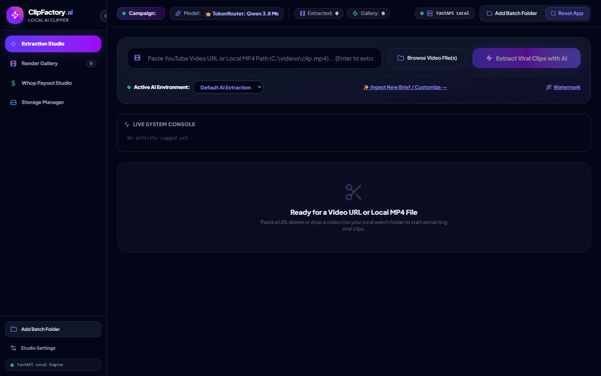
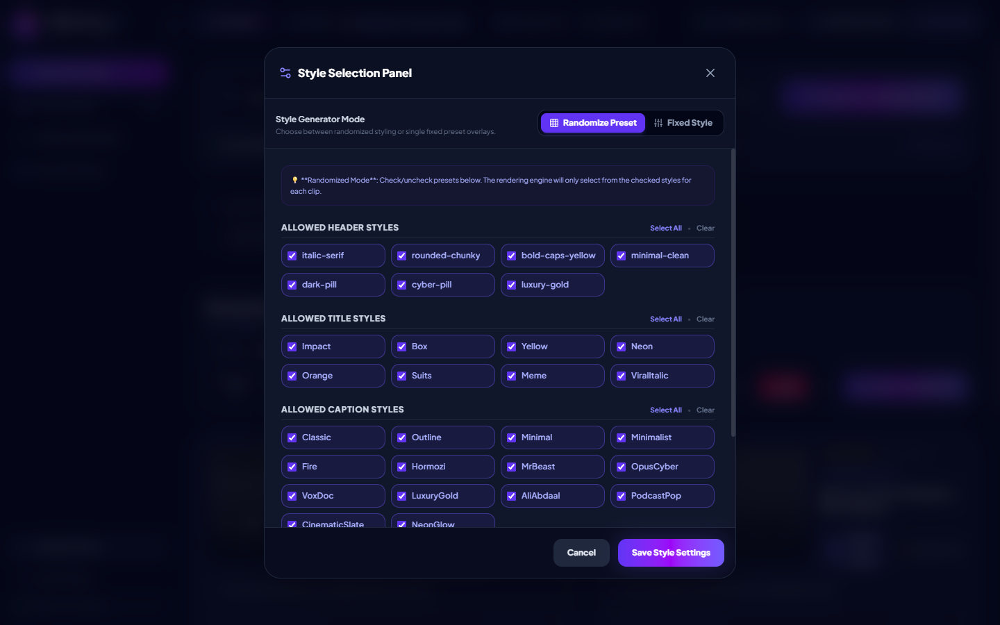
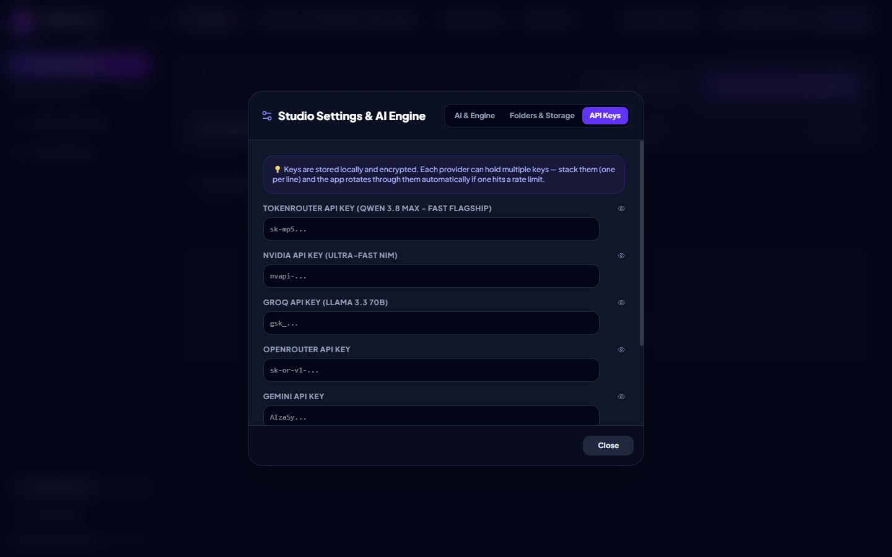

<div align="center">

# ClipFactory.ai

**Turn long-form YouTube videos into captioned, face-tracked 9:16 clips — powered by a multi-provider LLM pipeline and a studio-grade workspace.**

[](https://github.com/NiL4gh/clip-factory-public/releases/latest)
[](https://github.com/NiL4gh/clip-factory-public/actions/workflows/ci.yml)
[](LICENSE)
[](https://www.python.org/)
[](https://fastapi.tiangolo.com/)
[](https://nextjs.org/)

[Key Capabilities](#key-capabilities) · [Pipeline](#pipeline-architecture) · [UI Showcase](#ui-showcase) · [Quickstart](#quickstart) · [Configuration](#configuration) · [Project Structure](#project-structure) · [Testing & Contributing](#testing--contributing)



</div>

---

## Key Capabilities

- **End-to-end pipeline** — download, transcribe, analyze, extract, and render from a single workspace.
- **Word-level transcription** — `faster-whisper` timestamps drive accurate captions and clip boundaries.
- **Dual signal analysis** — `librosa` RMS audio-energy peaks plus `PySceneDetect` visual scene cuts.
- **3-pass LLM extraction** — Pass 0 detects the speaker persona, Pass 1 indexes topics, Pass 2 extracts per-topic clips with multi-segment stitching.
- **Multi-provider LLM rotation** — automatic key rotation and rate-limit handling across TokenRouter, NVIDIA NIM, Groq, OpenRouter, Gemini, and GLM.
- **Speaker-aware framing** — YuNet ONNX face tracking keeps the active speaker centered in a 9:16 frame.
- **Studio-grade styling** — 7 header presets with keyword accent colors, 14+ ASS caption styles, below-box / on-video placement, silence removal, and an optional global watermark.
- **Fast rendering** — hardware encoding via NVENC, with AMF/QSV detection and automatic `libx264` fallback.
- **Audio polish** — two-pass loudness normalization plus smart BGM mixing that swells at the peak moment.
- **Publishing exports** — Whop-style 7-day schedule package with daily slots and manifests, plus ZIP and CSV export.
- **Runs locally as a portable Windows desktop app (PyInstaller + pywebview) or local FastAPI + Next.js studio.**

---

## Pipeline Architecture

```mermaid
flowchart LR
    SRC["YouTube URL / local MP4"] --> DL["downloader.py<br/>yt-dlp + Deno n-challenge"]
    DL --> TR["transcriber.py<br/>faster-whisper word timestamps"]
    TR --> AA["audio_analyzer.py<br/>librosa RMS energy"]
    TR --> SA["scene_analyzer.py<br/>PySceneDetect cuts"]
    AA --> P0["Pass 0: Persona detection"]
    SA --> P0
    P0 --> P1["Pass 1: Topic indexing"]
    P1 --> P2["Pass 2: Per-topic clip extraction"]
    P2 --> FT["face_tracker.py<br/>YuNet speaker tracking"]
    FT --> CL["clipper.py + overlays.py<br/>9:16 render + captions + headers"]
    CL --> EN["enhancer.py + music_fetcher.py<br/>loudnorm + BGM mix"]
    EN --> EX["Whop package / ZIP / CSV export"]
```



LLM extraction is API-based. Add one or more provider keys in `.env` or the Settings UI — with no key configured, LLM extraction is unavailable.

---

## UI Showcase

<table>
  <tr>
    <td width="50%"></td>
    <td width="50%"></td>
  </tr>
  <tr>
    <td><b>Style panel</b> — choose header presets, caption styles, placement, and per-clip render settings.</td>
    <td><b>Settings</b> — manage local models, folders, and API keys from one modal.</td>
  </tr>
</table>

---

## Quickstart

### Option A — Windows Portable Desktop App

1. Download **`ClipFactory-Windows-Portable.7z.001`** and **`ClipFactory-Windows-Portable.7z.002`** into the same folder from [GitHub Releases](https://github.com/NiL4gh/clip-factory-public/releases/latest).
2. Extract **`ClipFactory-Windows-Portable.7z.001`** using [7-Zip](https://www.7-zip.org/) (right-click `.001` → **Extract Here**).
3. Run **`ClipFactory.exe`** inside the extracted `ClipFactory/` folder — Python, Node.js, and FFmpeg are all bundled.

The desktop wrapper (`run_app.py`) starts the FastAPI backend on a free local port and opens the UI in a native **pywebview** window. A single-instance lock prevents duplicate launches. To build it yourself, run `python build_exe.py` (see `ClipFactory.spec`).

### Option B — Local Development

**Requirements:** Python 3.9+, Node.js 20+, and FFmpeg on `PATH`.

```bash
git clone https://github.com/NiL4gh/clip-factory-public.git
cd clip-factory-public

python -m venv .venv
# Windows: .venv\Scripts\activate
source .venv/bin/activate

pip install -r requirements.txt

cd frontend
npm ci
npm run build
cd ..

uvicorn server.main:app --port 8000
```

Open `http://localhost:8000`. On Windows, `.\start_local.ps1` launches the same stack on port 8080 (override with `-Port`).

### Legacy / Experimental: Google Colab

[`colab_launcher.ipynb`](https://colab.research.google.com/github/NiL4gh/clip-factory-public/blob/main/colab_launcher.ipynb) is kept as a **legacy / experimental** option and is **untested on recent Colab runtimes**. To try it: open the notebook in Colab, set **Runtime → Change runtime type → T4 GPU**, run the setup cell, then the launch cell, and add `GEMINI_API_KEY` (or another provider key) as a **Colab Secret** for the best extraction quality.

---

## Configuration

Copy `.env.example` to `.env`. Every variable is optional — the app boots without keys, but LLM extraction requires at least one provider.

| Variable | Required | Purpose |
| --- | --- | --- |
| `GEMINI_API_KEY` | Optional | Google Gemini — the default provider |
| `GROQ_API_KEY` | Optional | Groq ultra-fast inference |
| `OPENROUTER_API_KEY` | Optional | OpenRouter model routing |
| `GLM_API_KEY` | Optional | Zhipu GLM |
| `NVIDIA_API_KEY` | Optional | NVIDIA NIM |
| `TOKENROUTER_API_KEY` | Optional | TokenRouter flagship models |
| `BASE_DIR` | Optional | Root data directory override |
| `WORK_DIR` | Optional | Working directory for intermediates |
| `OUTPUT_DIR` | Optional | Rendered clip output directory |
| `LLM_DIR` | Optional | Model directory override |
| `WHISPER_DIR` | Optional | Whisper model directory override |
| `PROJECTS_DIR` | Optional | Saved project directory override |
| `COOKIE_PATH` | Optional | Custom path to `cookies.txt` |

Multiple comma-separated keys per provider are supported for rotation, e.g. `GEMINI_API_KEY=key1,key2`.

**Cookies (optional):** copy `cookies.txt.example` to `cookies.txt` in the project root only when YouTube requires sign-in — age-gated, members-only, bot-check, or region-locked videos. Use a throwaway account and never commit the file; it is already listed in `.gitignore`.

---

## Project Structure

```text
clip-factory-public/
├── .github/
│   ├── ISSUE_TEMPLATE/
│   └── workflows/ci.yml
├── docs/
│   └── screenshots/
│       ├── settings-modal.png
│       ├── studio-workspace.png
│       └── style-panel.png
├── frontend/                    # Next.js 16 static export (output: "export")
│   ├── public/
│   ├── src/
│   │   ├── app/                 # layout.tsx, page.tsx, globals.css
│   │   ├── components/          # business/, campaigns/, editor/, ui/, studio shells
│   │   └── lib/utils.ts
│   ├── next.config.ts
│   └── package.json
├── server/
│   ├── __init__.py
│   └── main.py                  # FastAPI app, REST + WebSocket routes
├── shorts_generator/
│   ├── assets/                  # BebasNeue-Regular.ttf, YuNet ONNX model
│   ├── scripts/render_header_thumbnails.py
│   ├── audio_analyzer.py        # librosa RMS energy peaks
│   ├── cache.py                 # per-video JSON cache
│   ├── clipper.py               # FFmpeg render, ASS captions, silence removal
│   ├── config.py                # paths, fonts, model catalog
│   ├── downloader.py            # yt-dlp + Deno n-challenge, local MP4 resolution
│   ├── editor.py                # clip editor helpers
│   ├── enhancer.py              # loudness normalization + BGM mixing
│   ├── face_tracker.py          # YuNet ONNX speaker tracking
│   ├── highlights.py            # 3-pass LLM extraction
│   ├── logger.py                # WebSocket + file logging
│   ├── media.py                 # optional B-roll image fetch
│   ├── music_fetcher.py         # no-copyright BGM download
│   ├── overlays.py              # 7 header presets with keyword accents
│   ├── scene_analyzer.py        # PySceneDetect scene cuts
│   ├── transcriber.py           # faster-whisper word-level timestamps
│   └── youtube_metadata.py      # YouTube metadata generation
├── tests/                       # pytest suite
├── work/                        # runtime workspace (fonts, thumbnails)
├── .env.example
├── build_exe.py                 # PyInstaller portable build
├── ClipFactory.spec             # PyInstaller spec
├── colab_launcher.ipynb
├── CONTRIBUTING.md
├── cookies.txt.example
├── LICENSE
├── README.md
├── requirements.txt
├── run_app.py                   # pywebview desktop wrapper
└── start_local.ps1              # Windows local launcher
```

---

## Testing & Contributing

**Backend tests**

```bash
python -m pytest tests -q
```

**Frontend typecheck + build**

```bash
cd frontend
npx tsc --noEmit
npm run build
```

CI runs both jobs on every push and pull request to `main` via [`.github/workflows/ci.yml`](.github/workflows/ci.yml). Contributions are welcome — see [CONTRIBUTING.md](CONTRIBUTING.md) for setup and PR guidelines.

Released under the [MIT License](LICENSE).
